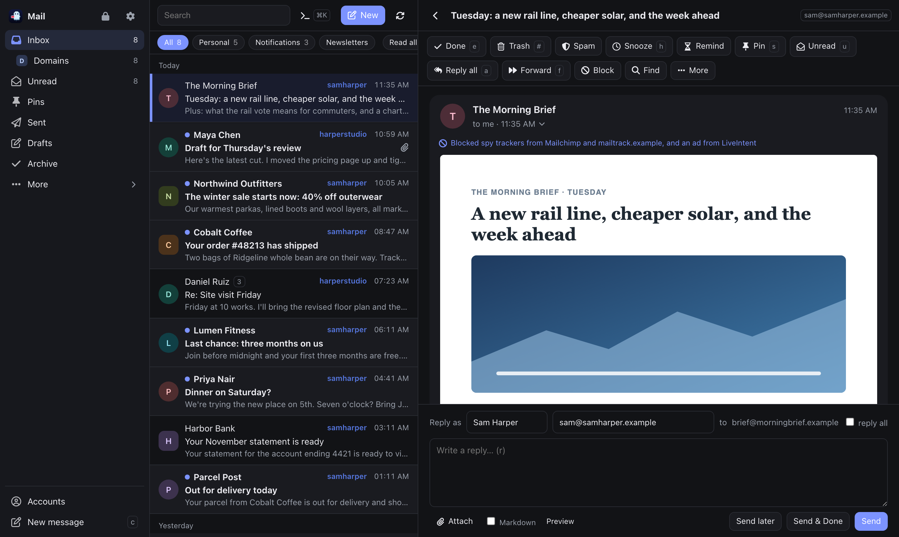
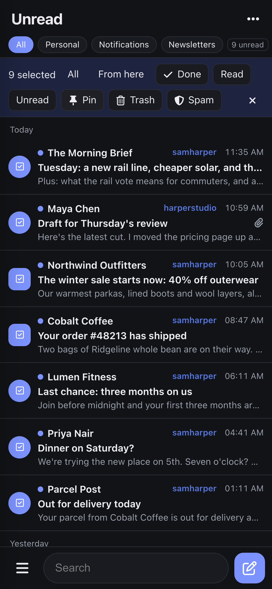
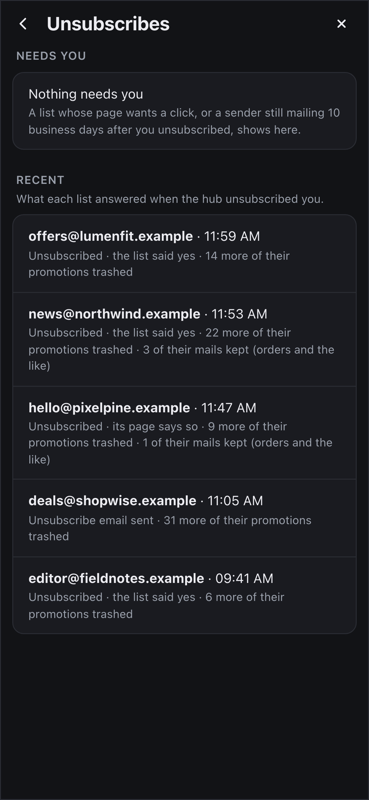
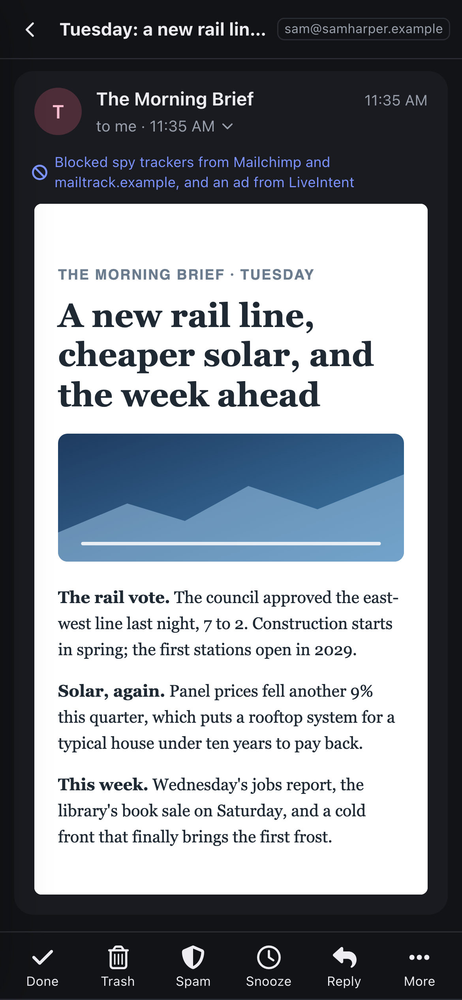
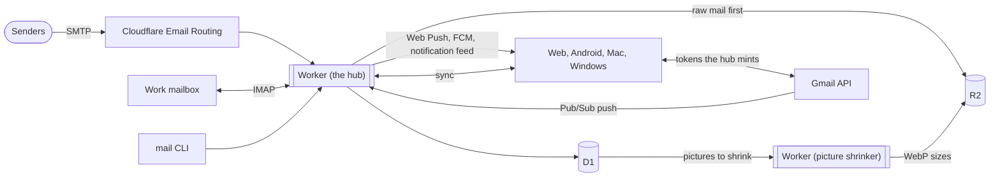

<p align="center">
  
</p>

<h1 align="center">Sherit Mail</h1>

<p align="center">All your domains, Gmail accounts and work mail in one inbox, on your own Cloudflare account.</p>

I have a bunch of domains and businesses, and I wanted all their mail in one inbox, for reading and for sending. I also had a work
mailbox on IMAP that needed to be in there. So I built my own mail app. I'm sure I'm not the first.

The server is one Cloudflare Worker on your own Cloudflare account. If you already pay for the $5 Workers plan, and you probably
do if you have several domains, it costs next to nothing on top of that.



I mostly use it to get through a lot of mail quickly. Unsubscribe and delete are one tap each. Senders can't tell when I open
their mail.

There are apps for the web, Android, Mac and Windows, and a command-line client.

## Triage

### Unsubscribing

Unsubscribe is one tap on any mail from a mailing list. If the sender supports one-click unsubscribe (RFC 8058), the hub uses it.
Otherwise it sends the unsubscribe email or loads the page itself, so nothing opens on your screen. The same tap trashes that
sender's other promotions in every account and leaves their orders, shipping notices and receipts alone. Settings has a log of
every unsubscribe and how it went.

### Unread

The Unread view shows everything unread in every account's inbox, plus anything unread in other folders from the last 90 days.
You can select all of it, everything below a row, or drag over the rows you want, then mark them read, done or trash. All of it
can be undone, and bulk actions from the last week are in a log.

<p>
  
  
  
</p>

### Keys, swipes and ⌘K

Almost everything has a shortcut: e for done, # for trash, h for snooze, r to reply, f to forward, c for a new message. You can
remap them in Settings, and ⌘K opens a command bar for everything else. On a phone each side has a short and a long swipe, and you
choose what they do. For replies you type a lot there are snippets: type `;name` and press Tab, and placeholders like `{{first}}`
and `{{date}}` get filled in. You can also write in Markdown, schedule a send, or send and mark done in one step.

### Notifications

If I handle a mail on one device, its notification disappears from the others, including a phone that's asleep. On my phone in
deep sleep it went away in under two seconds. You pick which buttons a notification has (Done, Read, Trash, Snooze, Reply, or no more
notifications from that sender), and on Android you can reply from the notification. I deal with a lot of mail without opening the app at all.

### Rules

If you turn on Screen first-time senders, mail from new senders waits in a strip above the inbox until you let it in. Priority
senders go to the top. Conversations can be muted, snoozed, set aside or marked to reply later. There are also:

- Spam on your own domains. They don't have a spam folder, so Spam trashes the conversation and blocks the sender in one tap, and
  Undo puts both back.
- "Delete unless it mentions", which trashes a sender's mail unless it contains words you choose. It works on Gmail, your domains
  and the work mailbox, and it can also go through the mail you already have.
- Trash rules, which match words in a sender's name or a subject, in one account or all of them.
- Quiet rules, for routine mail like password resets and sign-in codes that you want delivered without a notification.
- Address locks. An address on your domain belongs to the first company that writes to it, and mail to it from anyone else goes to
  Held with no notification. Any address you make up that starts with `x-` locks itself the same way, so you can see who passed it
  on.

### Domains

All your domains share one Domains entry in the sidebar, and each row shows which domain the mail came in on. Chips above the list
show which domains have mail and how much is unread, and tapping one filters to it. You can give a domain its own sidebar entry in
Settings. Mail you send from a business domain can go out with that business's letterhead (logo, colour, footer). Newsletters have
their own chip and a Cards view for skimming.

## Privacy

- The hub downloads a mail's pictures when the mail arrives and serves them from its own storage. The sender sees that download
  when the mail lands, not when you read it, and never from your IP. Apple Mail and Proton work the same way. Pictures you haven't
  looked at in 90 days are deleted, and if you open that mail again they're fetched from the sender, which is the only time a sender
  can see an open.
- Spy trackers are blocked before anything loads. The hub uses a list of known tracking companies, EasyPrivacy, and trackers it
  learns from your own mail. The lists miss a lot: over two weeks, 139 tiny pictures got past them (93 tracker pixels, 30 ad-slot
  beacons and 16 spacers). If a link pattern keeps serving a 1×1 picture at a different URL in every mail and never a real picture,
  it's treated as a tracker. A new pattern is watched for two weeks before it blocks anything, and if it later serves a real picture
  it's switched off.
- Ads are removed along with their links, using EasyList plus the ad slots newsletters fill through LiveIntent and Jeeng. Each mail
  shows what was blocked.
- Tracking parameters are stripped from links, and hovering a link shows where it actually goes.
- A mail that pretends to be from a brand (a fake party invite, say) and links to a domain registered a few days ago gets a warning
  before you click. I ran 1,333 of my own mails through the check: no false alarms on real mail, and it caught the fake.
- Clicking an attachment shows a preview, and nothing opens by itself. PDFs are rendered by PDF.js inside the app instead of being
  handed to your PDF reader.
- On Android, notification previews are encrypted for that phone before they go through Google.

It's had three security reviews so far, and the last two assumed the attacker had read all of this code.

## Speed and reliability

- The app draws from what's already on your device first. On a phone holding 6,640 conversations the first screen shows up in
  48 ms, measured by the app's own Speed panel.
- A notification brings its mail with it, so the mail is already there when you open the app: 102 ms after the first screen,
  down from about a second.
- Actions show on screen immediately and sync to the server in the background, in order, with retries. Offline they queue up and go
  out when you're back. Each send carries an id, so a retry can't send it twice.
- Search runs on the device too (SQLite FTS5 in WebAssembly). It understands Gmail operators like `in:trash`, `has:attachment` and
  `older_than:`, and merges in results from the server.
- Large pictures are shrunk when they arrive (500 KB and up, wider than 1080 px, or a PNG of 20 KB or more) by a WebAssembly shrinker I
  wrote for the hub on top of libjpeg-turbo, libspng, giflib and libwebp. It processes a strip of rows at a time, so a 36-megapixel
  JPEG needs about 10 MB of memory. Each picture gets a 1600 px and a 1080 px WebP, a size is kept only if it's under 80% of the
  original, and phones get the smaller one. GIFs stay animated and colour profiles are kept. On a week of real mail, PNGs between 50
  and 500 KB came out at about a fifth of their size. A mail's first pictures load first, and the next few mails' pictures are
  fetched before you open them.
- The hub records every picture's size, so an open mail is the right height from the start instead of growing as pictures load.
- Pinch zoom works on wide newsletters on a phone.
- Incoming mail is written to storage before anything else happens to it. If the database misses something, a reconciler replays
  it, and a daily sweep catches anything that was never indexed.
- Before turning off the backup copy in Gmail, I made the database write and the storage write fail on purpose on the live hub to
  make sure mail still came in. That's how I found the emergency copy had been broken for three weeks, so I fixed that first.
- Drafts save as you type and sync to your other devices, attachments included.

## How it works



The hub (`hub/src/index.js`) is one Worker. It takes mail in through Email Routing, sends it, syncs the work mailbox over IMAP,
fetches pictures and checks them for trackers, and runs a once-a-minute cron for send-later, snoozes, reminders and a backup Gmail
poll. Every morning it emails you a report of what it did.

The picture shrinker (`hub/img/`) is a second Worker. Every minute it takes the pictures the hub queued and writes their WebP sizes
with a WebAssembly module built from `hub/img/wasm/shrink.c`. It gets its own isolate, so a huge picture can't eat the memory the
mail needs.

Raw messages live in R2. Everything else (threads, rules, the change feed) is in D1. Gmail accounts connect with OAuth: the hub
keeps each refresh token encrypted and hands out short-lived access tokens, so the apps talk to Gmail directly.

It's cheap to run. One query that every device ran on refresh used to read the whole change table, about 216 million rows a week;
now each refresh reads two rows. Storing the shrunk pictures costs about $0.09 a month at my volume.

The apps are one client in plain JavaScript (`hub/src/client/`), no framework. It runs in the browser and inside each native shell:
Kotlin on Android, Swift on the Mac, Tauri with WebView2 on Windows.

```
hub/        the Worker and the web client; migrations/, test/
hub/img/    the picture shrinker: its Worker (src/) and WebAssembly module (wasm/)
android/    Kotlin app (WebView, Firebase Cloud Messaging)
mac/        Swift app (AppKit, WKWebView)
windows/    Rust app (Tauri v2, WebView2), built on the Mac
cli/mail    the command-line client
```

## Run your own

You'll need a Cloudflare account on the Workers Paid plan with Email Routing turned on for your domains, a recent Node (the tests
use the built-in `node:sqlite`) and `wrangler`.

Change these to yours:

- **`hub/wrangler.toml`:** the route (`mail.yourdomain.example`), your D1 `database_id`, `DOMAINS`, `ALLOWED_GOOGLE_EMAIL`,
  `FORWARD_TO`, `IMAP_ACCOUNTS` (or `[]`), `BRANDS` (or `{}`), and the Gmail push settings (blank means push is off).
- **`hub/img/wrangler.toml`:** the same D1 `database_id`.
- **The hub's address in each app:** `android/app/src/main/java/com/sheritlabs/mail/Hub.kt` (`ORIGIN`, `HOST`),
  `mac/Sources/SheritMail/AppDelegate.swift` (`HUB`), `windows/src-tauri/src/core.rs` (`HUB`, `HUB_HOST`, the origin check),
  `windows/src-tauri/tauri.conf.json` and `capabilities/hub.json`, and `cli/mail` (or `~/.config/mailhub/url`).
- **Signing:** the Windows updater key (`cargo tauri signer generate`, with its public half in `tauri.conf.json`), the Android
  release key and the Mac Developer ID are your own.

Then:

```bash
cd hub
npm install
npx wrangler d1 execute mailhub --remote --file migrations/0001_init.sql   # each migration in order, one file at a time
npx wrangler deploy
cd img && npx wrangler deploy   # the picture shrinker
```

`hub/img/wasm/shrink.wasm` is committed. If you want to rebuild it, `hub/img/wasm/build.sh` does that from the libraries'
checksummed sources with Homebrew's LLVM (`brew install llvm lld wasi-libc wasi-runtimes`).

Run a new migration before you deploy the code that uses it. Secrets go in with `npx wrangler secret put NAME`:

| Secret | For |
|---|---|
| `SESSION_SECRET` | signing sign-in sessions |
| `GOOGLE_CLIENT_ID`, `GOOGLE_CLIENT_SECRET` | signing in to the hub with Google |
| `GMAIL_CLIENT_ID`, `GMAIL_CLIENT_SECRET`, `GMAIL_TOKEN_KEY` | connecting Gmail accounts; the key encrypts refresh tokens |
| `GMAIL_PUSH_SECRET` | checking Gmail's Pub/Sub pushes |
| `VAPID_PUBLIC_KEY`, `VAPID_PRIVATE_KEY`, `VAPID_SUBJECT` | Web Push |
| `CLI_TOKEN` | the `mail` CLI |
| `FCM_SERVICE_ACCOUNT` | Android push (a Firebase service account's JSON); without it Android gets no push |
| `UI_PASSWORD` | optional: a password sign-in next to Google |

A work mailbox gets added in Settings. Its password is checked against the server and then kept encrypted. A mailbox listed in
`IMAP_ACCOUNTS` can read its password from a secret instead.

The CLI reads `~/.config/mailhub/url` and `~/.config/mailhub/token`:

```bash
mail inbox 20
mail send --from you@yourdomain.example --to a@b.com --subject Hi --body "Hello"
mail stats
```

The Mac app builds with `mac/build.sh --install` (you'll need Xcode and a Developer ID certificate). The Windows app builds on the
Mac with `windows/build.sh`; `--publish` uploads it to the hub, and installed copies update themselves.

## Tests

126 test files: the Worker against real SQLite, the client in jsdom against a fake network, the picture shrinker against sharp, and
Playwright driving phone, tablet and desktop sizes. `python3 test/run_all.py` (in `hub/`) runs all of them in parallel, in a little
over two minutes on my Mac. `npm run test:smoke` and `npm run test:ingest` are the quick ones. `--control` also runs tests against
the code from before their fix, to check they would have caught the bug. The two picture-shrinker tests need `npm install` in
`hub/shrink` and `hub/shrink/container` first.

## Licence

GNU AGPL-3.0 (see `LICENSE`). If you run a modified Sherit as a service, the AGPL asks you to publish your changes. If you want to
use it on other terms, Sherit Labs sells a commercial licence. Read `CONTRIBUTING.md` before sending code. Third-party code and lists
are credited in `hub/NOTICE.md`.
